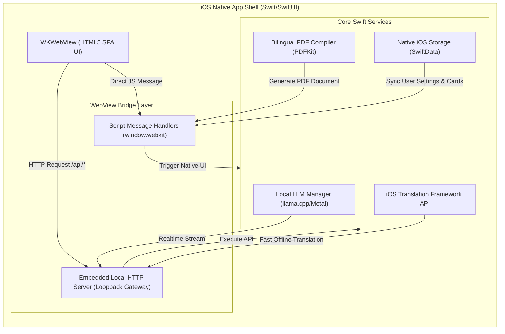

## Aprendelo — Web & iOS Application Specification (v4.0 - Hybrid Static & iOS Offline Architecture)

This document outlines the design and architectural goals for a comprehensive language learning sandbox designed to help English speakers learn Spanish and other target languages.

---

### 1. Architectural Philosophy

The application utilizes a dual-target architecture:
*   **Web Target (Hybrid Static/Local)**:
    *   **Static Layer**: Features relying purely on deterministic logic or local data (Flashcards and Conjugation) are hosted entirely statically. The UI and these tools operate smoothly on simple static hosts.
    *   **Local Layer (Advanced LLM)**: Deep, generative tools (Chat, Translation, Booklet Builder) require a local Python/Flask server processing requests to `localhost:11434` (Ollama).
    *   **Zero-Config Enforcement**: Instead of the frontend querying for existence of the backend, the initial `index.html` document contains explicit static warnings masking the advanced LLM HTML. When the Python Flask app is run locally, it processes the `index.html` file on server startup, unmasks the advanced features, and securely serves the unified codebase.
*   **iOS Target (Fully Offline / Zero-Dependency)**:
    *   **Absolute Independence**: The application is packaged as a standalone iOS app that executes all computation, machine learning, and translation on-device. No network access is required, enabling flight-mode and subway learning. Booklet/PDF functionality is not available in the iOS app.
    *   **On-Device AI Engine**: Replaces local Ollama calls with a tightly integrated native execution layer powered by Swift, metal acceleration, and Apple Neural Engine (ANE) hardware.
    *   **Native iOS SDK Integrations**: Leverages native translation frameworks and advanced system rendering tools to completely bypass external Python execution and custom binaries.

---

### 2. Feature Specifications

#### 2.1. Flashcard Mini-Games (Static JavaScript / Native Offline Store)
*   **Functionality**: Presents interactive flashcards for vocabulary recall testing. The user can flip the card and proceed to the next card.
*   **Implementation**: Completely stateless in web mode. On iOS, the application hooks into a localized persistent store (browser IndexedDB/localStorage or native SwiftData/CoreData) to track user progress, card review intervals (spaced repetition), and mastery metrics entirely offline.
*   **Mini-Games**:
    *   **Vocabulary Flashcards (2.1.1)**: Randomizes Spanish:English pairs at the B2 CEFR level using a static `flashcards.json` payload.
    *   **Flash-phrases (2.1.2)**: Presents English:Spanish phrases at the B2 CEFR level containing common grammar tenses using `flash-phrases.json`.
    *   **Flash-images (2.1.3)**: Pair cartoon images of common body parts, animals, and plants with their Spanish translations using `flash-images.json`.

#### 2.2. Verb Conjugation Tool (Deterministic Client-Side Engine)
*   **Functionality**: Users input a Spanish verb (e.g., *hablar*). The tool instantly returns the conjugated forms for all pronouns in key tenses (Presente, Pretérito, Imperfecto, Futuro), highlights irregular forms, and provides English translations for each conjugated state.
*   **Data & Logic**: Built entirely in client-side JavaScript using deterministic algorithms for regular verb inflection rules combined with a robust lookup table for common irregular verbs, functioning completely offline on both Web and iOS targets.

#### 2.3. Conversational AI Chat
*   **Functionality**: Open-ended conversational interface using a native Spanish tutor persona calibrated to a selected CEFR proficiency level (A1-C2). Gently enforces grammar rules and introduces new vocabulary without breaking immersion.
*   **Web Target**: Streams responses from the Flask backend via Server-Sent Events (SSE), which communicates with the local Ollama daemon.
*   **iOS Target (On-Device LLM)**: Powered by a native, metal-accelerated inference engine running quantized models directly on the Apple Neural Engine. See Section 3.2 for architecture.

#### 2.4. Language Translator
*   **Functionality**: Instant side-by-side string translation. Clears context instantly when the prompt is cleared to ensure a clean prompt interface.
*   **Web Target**: streams translations from the local Ollama backend scoped to selected CEFR proficiency constraints.
*   **iOS Target (On-Device Translation)**: Uses highly-optimized translation APIs native to the iOS system, operating instantaneously without downloading giant custom LLM models for simple dictionary tasks. See Section 3.3 for details.

#### 2.5. Bilingual Booklet Builder
*   **Functionality**: Takes an English `.txt` upload, restructures/simplifies paragraph breaks, generates contextual translations tailored to a target proficiency, and generates a formatted parallel bilingual PDF (side-by-side page columns or saddle-stitch print alignment).
*   **Web Target**: Uses Python's `reportlab` inside a Flask backend with Ollama for text restructuring and translation.
*   **iOS Target (On-Device PDF Generation)**: Utilizes native Apple rendering libraries to compile and layout paragraphs on-device, outputting the final PDF straight to the system Share Sheet. See Section 3.4 for layout logic.

#### 2.6. Sentence Builder (Hybrid Static & AI Playground)
*   **Functionality**: Generates dynamic jumbled-word sentence construction games. When an LLM is active, it generates contextual Spanish sentences and distractors. When offline or static, it serves as a fallback utilizing random seeds from `flash-phrases.json` and client-side distractor generation.
*   **Web Target**: Uses local Flask backend + Ollama for intelligent distractor generation and semantic grading (accepting natural Spanish structural flexibility like dropped pronouns and alternate phrasing).
*   **iOS Target**: Runs the local on-device LLM to generate the lesson JSON payload and evaluate the user's free-form or jumbled word submissions dynamically, saving successfully completed exercises into the local flashcard deck.

---

### 3. iOS Offline Application Architecture

#### 3.1. App Shell & WebView Integration
*   **Hybrid Wrapping**: Built as a native Swift/SwiftUI application wrapping a modern WebKit `WKWebView`. The entire web frontend (`index.html`, CSS, icons, static assets, and local JSON dictionaries) is packaged as a local directory in the iOS App Bundle.
*   **Unified Loopback Gateway**: To preserve the modular frontend JavaScript architecture without extensive codebase rewrites, the Swift wrapper spins up a lightweight, highly secure embedded HTTP loopback server (e.g., using `Swifter` or `GCDWebServer` restricted to `127.0.0.1`).
    *   API requests targeting `/api/*` are captured by the loopback server, executed using native Swift services, and returned in identical JSON or SSE formats.
*   **Zero-Config Enforcement**: The static warning masks in `index.html` are stripped automatically at runtime. The web view is fed a virtual runtime environment that reports local API capability as `true` from startup.

#### 3.2. On-Device LLM Subsystem (Metal/ANE Acceleration)
*   **Inference Engine**: Employs a native integration of **llama.cpp** (via `llama.swift` Swift package wrapper) targeting Apple Metal and the Apple Neural Engine (ANE) for highly optimized GPU-bound execution.
*   **Model Selection**:
    *   **Primary Model**: **Llama-3.2-3B-Instruct** (4-bit quantized, Q4_K_M GGUF). This model offers a highly compact footprint (~2.0GB storage / RAM), executing at exceptional speeds on devices with 6GB+ RAM (iPhone 15 Pro and newer) while preserving CEFR parameter sensitivity.
    *   **Ultra-lightweight Fallback**: **Llama-3.2-1B-Instruct** (4-bit quantized GGUF). Kept as a fallback for older devices with 4GB RAM to guarantee smooth background operations and avoid memory limit terminations (iOS Jetsam events).
*   **RAM & Battery Optimization**: 
    *   The model is only loaded into memory when an LLM-related activity (Chat or Sentence Builder) is active. 
    *   A timeout auto-releases the model allocation after 3 minutes of inactivity to keep the system overhead ultra-low.

#### 3.3. On-Device Translation Subsystem
*   **iOS 18 Native Translation API**: Leverages the system's native `Translation` Swift framework. 
    *   Utilizes the offline neural machine translation models preloaded or downloaded on demand by the iOS system.
    *   Provides extremely fast, high-quality translation between English and Spanish/French/German/Italian with zero CPU overhead for the application itself, as translation models run in a dedicated system daemon.
*   **CoreML / ONNX Runtime Fallback**: For iOS 17 and below, the app packages a highly compressed **MarianMT** or **NLLB-200-distilled-600M** translation model run locally via the ONNX Runtime Swift API or converted to Apple CoreML format.

#### 3.4. On-Device Bilingual Booklet Builder (Native PDFKit)
*   iOS version contains no booklet, nor PDF generation capability. That menu item is hidden on iOS.

#### 3.5. Persistence & Cross-Platform Sync
*   **Local Storage**: Flashcard data, vocabulary statistics, and custom Sentence Builder generated content are stored locally in **SwiftData** (or SQLite) natively, mapped seamlessly to the browser's IndexedDB engine via custom JavaScript script injections.
*   **Cross-Device Backup**: If internet connectivity is restored, statistics can optionally sync with Apple's secure private **iCloud Key-Value Store** or **CloudKit** natively without registering for an external server account.