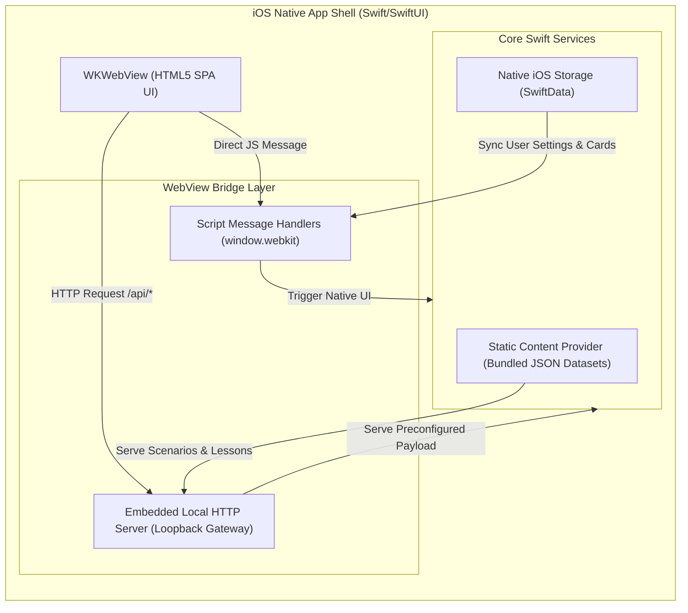

## Aprendelo — Web & iOS Application Specification (v4.0 - Hybrid Static & iOS Offline Architecture)

This document outlines the design and architectural goals for a comprehensive language learning sandbox designed to help English speakers learn Spanish and other target languages.

---

### 1. Architectural Philosophy

The application utilizes a dual-target architecture:
*   **Web Target (Hybrid Static/Local)**:
    *   **Static Layer**: Features relying purely on deterministic logic or local data (Flashcards and Conjugation) are hosted entirely statically. The UI and these tools operate smoothly on simple static hosts.
    *   **Local Layer (Advanced LLM)**: Deep, generative tools (Chat, Translation, Sentence Builder, Adaptive Quiz) require a local Python/Flask server processing requests to `localhost:11434` (Ollama).
    *   **Zero-Config Enforcement**: Instead of the frontend querying for existence of the backend, the initial `index.html` document contains explicit static warnings masking the advanced LLM HTML. When the Python Flask app is run locally, it processes the `index.html` file on server startup, unmasks the advanced features, and securely serves the unified codebase.
*   **iOS Target (Fully Offline / Zero-Dependency)**:
    *   **Absolute Independence**: The application is packaged as a standalone iOS app that executes all computation and data rendering locally on-device. No network access is required, enabling flight-mode and subway learning. Language Translation and Adaptive Quiz functionalities are completely omitted and hidden in the iOS app.
    *   **Preconfigured Static Data Engine**: Replaces local LLM calls on iOS with deterministic, offline static content datasets (JSON) bundled directly into the app package, ensuring lightweight, instant performance without high memory overhead or process termination risks.
    *   **Native iOS SDK Integrations**: Leverages native UI tools and offline JSON datasets, completely bypassing external Python execution or custom binary runtimes while hiding desktop-only features (Translation and Quiz).

---

### 2. Feature Specifications

#### 2.1. Flashcard Mini-Games (Static JavaScript / Native Offline Store)
*   **Functionality**: Presents interactive flashcards for vocabulary recall testing. The user can flip the card and proceed to the next card.
*   **Implementation**: Completely stateless in web mode. On iOS, the application hooks into a localized persistent store (browser IndexedDB/localStorage or native SwiftData/CoreData) to track user progress, card review intervals (spaced repetition), and mastery metrics entirely offline.
*   **Mini-Games**:
    *   **Vocabulary Flashcards (2.1.1)**: Randomizes Spanish:English pairs at the B2 CEFR level using a static `flashcards.json` payload.
    *   **Flash-phrases (2.1.2)**: Presents English:Spanish phrases at the B2 CEFR level containing common grammar tenses using `flash-phrases.json`.
    *   **Flash-images (2.1.3)**: Pair cartoon images of common body parts, animals, and plants with their Spanish translations using `flash-images.json`.

#### 2.2. Verb Conjugation Tool (Deterministic Client-Side Engine)
*   **Functionality**: Users input a Spanish verb (e.g., *hablar*). The tool instantly returns the conjugated forms for all pronouns in key tenses (Presente, Pretérito, Imperfecto, Futuro), highlights irregular forms, and provides English translations for each conjugated state.
*   **Data & Logic**: Built entirely in client-side JavaScript using deterministic algorithms for regular verb inflection rules combined with a robust lookup table for common irregular verbs, functioning completely offline on both Web and iOS targets.

#### 2.3. Conversational Practice (Web: AI Chat / iOS: Scenario Dialogue Engine)
*   **Functionality**: Interactive conversational interface designed to practice Spanish at a selected CEFR proficiency level (A1-C2).
*   **Web Target**: Streams open-ended AI tutor responses from the Flask backend via Server-Sent Events (SSE), which communicates with the local Ollama daemon.
*   **iOS Target (Preconfigured Scenarios)**: Operates purely offline using structured, interactive dialogue scenarios loaded from static JSON files (`chat-scenarios.json`). Users choose or assemble responses from branching conversational paths with instant pre-authored feedback, eliminating on-device LLM memory and latency overhead.

#### 2.4. Language Translator
*   **Functionality**: Instant side-by-side string translation. Clears context instantly when the prompt is cleared to ensure a clean prompt interface.
*   **Web Target**: Streams translations from the local Ollama backend scoped to selected CEFR proficiency constraints.
*   **iOS Target**: No translation functionality is implemented for iOS. The Translator menu item and section are completely hidden on iOS.

#### 2.5. Sentence Builder (Hybrid Static & AI Playground)
*   **Functionality**: Generates dynamic jumbled-word sentence construction games. When an LLM is active (Web mode), it generates contextual Spanish sentences and distractors. When offline or static (iOS mode), it operates deterministically using static JSON datasets.
*   **Web Target**: Uses local Flask backend + Ollama for intelligent distractor generation and semantic grading (accepting natural Spanish structural flexibility like dropped pronouns and alternate phrasing).
*   **iOS Target**: Uses preconfigured sentence templates and distractor pools from static JSON files (`sentence-builder.json` and `flash-phrases.json`) with client-side exact and fuzzy distractor evaluation, saving completed exercises into the local flashcard deck without LLM execution.

#### 2.6. Adaptive Quiz Engine (Web Only / LLM-Driven)
*   **Functionality**:
    *   **Topic & Proficiency Seeding**: Generates quizzes on a user-specified custom topic (e.g., *subjunctive triggers*, *travel vocabulary*, *past tense preterite vs imperfect*) or general Spanish knowledge tailored to the student's initial CEFR proficiency level (A1–C2).
    *   **Comprehensive Coverage**: Questions span all language domains—grammar inflection, vocabulary usage, reading comprehension, syntax reconstruction, and idiomatic expressions—focusing equally on testing and reinforcing knowledge.
    *   **Mixed Question Formats**: Each 10-question section comprises a dynamic mixture of:
        *   *Multiple Choice*: Prompt with 4 distinct options (one correct, three contextually plausible distractors).
        *   *Fill-in-the-Blank*: Sentence context with a missing conjugated verb or key vocabulary token.
        *   *Short Answer / Translation*: Short phrase or prompt requiring freeform text input in Spanish.
    *   **Section Structure & Batch Generation**:
        *   Quizzes progress in structured 10-question sections.
        *   All 10 questions for a section are batch-generated by the LLM upon section start, minimizing latency between individual questions.
    *   **Batch Evaluation & Reinforcement Review**:
        *   The user progresses through the 10 questions and submits the section upon completion.
        *   The LLM grades the entire 10-question batch, providing a comprehensive review showing: overall section score, question-by-question breakdown, correct answers, and instructional explanations reinforcing grammar and vocabulary concepts.
    *   **Dynamic Difficulty Adaptation (Zone of Proximal Development)**:
        *   Target difficulty continually adjusts between sections to keep material slightly challenging ("a little too hard"):
            *   *High Accuracy (≥ 75%)*: The target difficulty steps up to the next CEFR level (e.g., strong performance at B1 raises the target to B2 for the next section).
            *   *Low Accuracy (< 50%)*: The target difficulty steps down (e.g., poor performance at B1 adjusts down to A2 for the next section to reinforce fundamentals).
            *   *Moderate Performance (50%–74%)*: Retains the current target level for the subsequent section.
    *   **Visual Level Alerts**: The UI displays a persistent, prominent notification banner before and during each section alerting the student of the targeted proficiency level and any recent adjustments (e.g., *"Targeting Level B2 — Questions have stepped up based on your performance!"* or *"Targeting Level A2 — Difficulty adjusted to reinforce foundational concepts"*).
*   **Web Target**: Fully supported via the Python Flask backend with dedicated endpoints:
    *   `POST /api/quiz/generate`: Generates a 10-question section batch based on topic, current target level, and previous section context.
    *   `POST /api/quiz/evaluate`: Evaluates student answers, provides feedback explanations, and calculates the recommended CEFR level for the next section.
*   **iOS Target**: Omitted and hidden completely. The Quiz navigation tab (`#nav-quiz`) and section (`#section-quiz`) are hidden in the iOS app environment.

---

### 3. iOS Offline Application Architecture

#### 3.1. App Shell & WebView Integration
*   **Hybrid Wrapping**: Built as a native Swift/SwiftUI application wrapping a modern WebKit `WKWebView`. The entire web frontend (`index.html`, CSS, icons, static assets, and local JSON dictionaries) is packaged as a local directory in the iOS App Bundle.
*   **Unified Loopback Gateway**: To preserve the modular frontend JavaScript architecture without extensive codebase rewrites, the Swift wrapper spins up a lightweight, highly secure embedded HTTP loopback server (e.g., using `Swifter` or `GCDWebServer` restricted to `127.0.0.1`).
    *   API requests targeting `/api/*` are captured by the loopback server, executed using native Swift services or static JSON bundle assets, and returned in identical JSON formats.
*   **Zero-Config Enforcement**: The static warning masks in `index.html` are stripped automatically at runtime. The web view is fed a virtual runtime environment that reports local API capability as `true` from startup.

#### 3.2. Static Content & Data Bundle Subsystem
*   **Data Bundle Engine**: Replaces on-device LLM inference (such as MLX / llama.cpp / Gemma) with lightweight, preconfigured JSON datasets (`chat-scenarios.json`, `sentence-builder.json`, `flashcards.json`, `flash-phrases.json`, `flash-images.json`) bundled directly inside the iOS app package.
*   **Preconfigured Content Schemas**:
    *   **Chat Scenarios**: Branching dialogue trees per CEFR level with prompt options, expected target responses, and pre-computed translations.
    *   **Sentence Builder**: Curated sentence templates with tokenized jumbled word pools and distractor sets.
*   **Performance & System Stability**:
    *   **Zero RAM Overhead & Cold Starts**: Eliminates ~2.5GB model downloads and large RAM allocations, launching instantly.
    *   **High Stability**: Eliminates battery drain and iOS memory limit terminations (Jetsam events) completely across all iOS hardware generations.

#### 3.3. On-Device Translation Subsystem
*   Language Translation functionality is not exposed on iOS. The menu item (`#nav-translate`) and interface section (`#section-translate`) are completely hidden in the iOS app UI environment.

#### 3.4. On-Device Adaptive Quiz Subsystem
*   Adaptive Quiz functionality is not available on iOS. The menu item (`#nav-quiz`) and interface section (`#section-quiz`) are completely hidden in the iOS app UI environment.

#### 3.5. Persistence & Cross-Platform Sync
*   **Local Storage**: Flashcard data, vocabulary statistics, and custom Sentence Builder generated content are stored locally in **SwiftData** (or SQLite) natively, mapped seamlessly to the browser's IndexedDB engine via custom JavaScript script injections.
*   **Cross-Device Backup**: If internet connectivity is restored, statistics can optionally sync with Apple's secure private **iCloud Key-Value Store** or **CloudKit** natively without registering for an external server account.